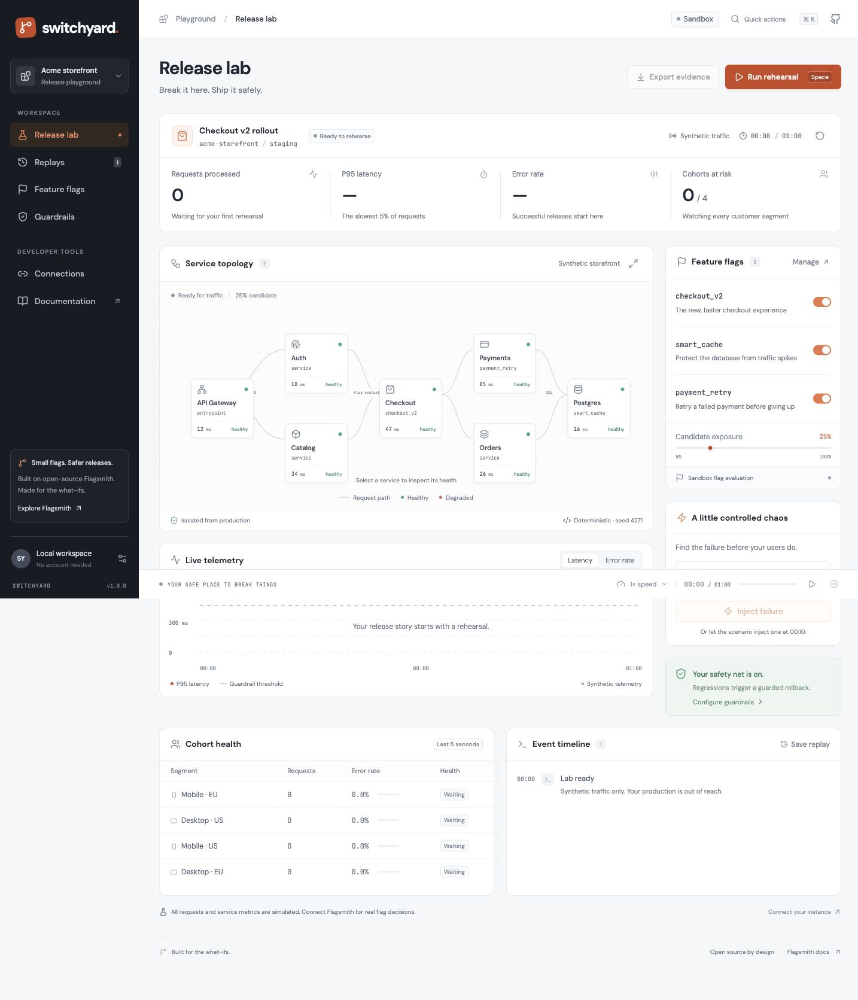

<div align="center">

# Switchyard

### Break it here. Ship it safely.

**A release-safety workbench for self-hosted Flagsmith.**

Rehearse a rollout. Inject a failure. Find the affected cohort.<br/>
Prove that flipping the flag brings the release back to safety.

[Try the sandbox](https://switchyard-release-lab.jocosetoffee16.chatgpt.site) · [Demo script](docs/DEMO.md) · [Architecture](docs/ARCHITECTURE.md) · [Hackathon fit](docs/HACKATHON.md)

MIT licensed · React + TypeScript · Official Flagsmith Node SDK · Docker Compose

</div>



## The problem

An aggregate error rate can hide a broken experience for a specific customer segment. A feature flag is useful only if a team can discover the regression, disable the right path, and demonstrate that the rollback actually worked.

Switchyard makes that workflow visible and reproducible in a synthetic release lab. Its default scenario injects a checkout v2 defect affecting **Mobile · EU** customers. Guardrails detect the sustained breach and request a checkout flag rollback. The defect remains active after rollback: recovery comes from selecting the stable implementation.

## What you can do

- Watch a seven-service topology with animated request paths and inspect service health.
- Run seeded, request-level rehearsals across four customer cohorts.
- Rehearse checkout regressions, payment timeouts, cache stampedes, and healthy releases.
- Change three feature flags to see how release and resilience decisions affect request outcomes.
- Configure aggregate, latency, and cohort guardrails with consecutive-breach protection.
- Compare guarded and unguarded runs using the same random draws.
- Save local replay snapshots and export JSON evidence with timeline, thresholds, seed, cohorts, and time series.
- Connect the official Flagsmith Node SDK to a self-hosted instance, evaluate 100 synthetic identities, and mutate allowlisted lab flags through its management API.
- Use the same engine from a CLI or GitHub Actions.

**Traffic, service latencies, topology, and incidents are always simulated.** Sandbox flags are local. Connected flag decisions and management mutations are real. This is a rehearsal tool, not a production observability platform or a prediction of production reliability. The hosted static preview is the browser sandbox; the self-hosted stack enables the live Flagsmith integration.

## Run locally in under a minute

Requires Node.js 24+ and npm.

```sh
git clone https://github.com/mario-lindev/switchyard.git
cd switchyard
npm ci
npm run dev
```

Open **http://localhost:5173**. The adapter runs at http://127.0.0.1:3001. No credentials are required for the sandbox.

Click **Run rehearsal**. At simulated second 10, the defect arrives. At the default seed, rollback is triggered at second 12. Choose **4× speed** to run the full minute in about 15 seconds. Explore **Replays → Compare guardrails** to inspect the counterfactual.

## Self-host the complete stack

Requires Docker Engine/Desktop with Compose v2.

```sh
cp .env.example .env
```

Set unique local-lab values for `POSTGRES_PASSWORD`, `DJANGO_SECRET_KEY`, and `WAREHOUSE_CREDENTIALS_SECRET`. Do not commit `.env`. Set `FLAGSMITH_IMAGE` to an official release tag if you need a pinned, reproducible deployment; the evaluation default follows Flagsmith's official `latest` Compose example.

```sh
docker compose up --build -d
```

The stack includes Postgres, Flagsmith's combined API/dashboard image, a database migration job, its task processor, and Switchyard. Ports bind to loopback:

| Service    | URL                   |
| ---------- | --------------------- |
| Flagsmith  | http://localhost:8000 |
| Switchyard | http://localhost:3001 |

1. Create an account at **http://localhost:8000/signup**.
2. Create a dedicated **Switchyard lab** project and environment. Never use a production environment for this demonstration.
3. In Flagsmith's environment settings, create a **server-side SDK key**. Set `FLAGSMITH_ENVIRONMENT_KEY` in `.env`.
4. Set `FLAGSMITH_ENVIRONMENT_ID` to the environment's API key used in management API URLs. This is distinct from the server-side SDK key.
5. Create a management API token with permissions for this lab project. Set `FLAGSMITH_MANAGEMENT_TOKEN` and `FLAGSMITH_PROJECT_ID` in `.env`.
6. With Node.js installed on the host, seed the three flags:

   ```sh
   npm ci
   npm run flagsmith:seed
   ```

7. Check the flags in the dashboard. All three should be enabled. `checkout_v2` has a numeric remote config value of **25** for 25% candidate exposure. Existing flags are preserved by the seed command, so verify their values if you rerun setup.
8. Set `ALLOW_FLAG_MUTATIONS=true`, then recreate Switchyard to reload the environment:

   ```sh
   docker compose up -d --force-recreate switchyard
   ```

9. Open Switchyard and select **Connections → Check connection**. It should report **Self-hosted**. Run the checkout rehearsal while watching the Flagsmith dashboard: `checkout_v2` should change to disabled when the guardrail trips.

Inside Compose, the adapter uses `http://flagsmith:8000/api/v1/`. For `npm run dev`, the `.env.example` URL uses `http://localhost:8000/api/v1/`.

### How connected exposure works

The official SDK evaluates `visitor-0` through `visitor-99` with consistent `device`, `region`, `rollout_bucket`, and `switchyard_lab` traits. Identities are transient. The application interprets the numeric `checkout_v2` value as an exposure percentage and compares it with a stable FNV bucket. This bucketing is Switchyard logic driven by Flagsmith remote config, **not a claim to use Flagsmith's built-in percentage-split engine**. Flagsmith segment/identity overrides can change the returned enabled state or remote value.

Environment evaluation supplies the global kill switch; per-identity evaluation supplies candidate assignments. A rollback requires management API acknowledgment, SDK read-back, and verification that none of the 100 evaluated identities still enables the checkout path. An overriding identity that stays enabled makes the rollback fail visibly instead of showing false recovery.

The two resilience flags currently use environment-wide evaluations. Assignments are sampled at run start; arbitrary mid-run remote segment changes require a new rehearsal. Environment flags are polled every five seconds.

## Verify and run headlessly

```sh
npm test
npm run build
npm run rehearse -- --seed=4271 --out=report.json
npm run rehearse -- --no-rollback --assert-safe
```

`--assert-safe` exits with code 1 if a guardrail threshold was crossed during the run, including a run that later recovered. Choose `--scenario=checkout-regression`, `payment-outage`, `cache-stampede`, or `healthy-release`. The CLI is sandbox-only; it never mutates remote flags.

For seed 4271, the default guarded checkout scenario processes **7,200 synthetic requests**, observes **33 failures**, and rolls back at **12 seconds**. These are reproducible simulation results, not production metrics. [Example evidence](docs/example-evidence.json) is committed for inspection.

GitHub Actions runs the test suite, builds the application, and uploads the rehearsal JSON as an artifact.

## Reuse it in your own tooling

The simulation engine is a pure TypeScript module; it has no React, network, or browser dependency:

```ts
import { evidence, runHeadless } from "./src/engine.ts";

const guarded = runHeadless({ seed: 4271, autoRollback: true });
const unguarded = runHeadless({ seed: 4271, autoRollback: false });

console.log(unguarded.totalErrors - guarded.totalErrors);
console.log(evidence(guarded));
```

`server/adapter.mjs` is separately reusable and accepts injected SDK/fetch dependencies. `createApp()` accepts configuration and an adapter, making the API easy to test without a real Flagsmith server.

## Verification scope

The automated suite covers the engine, rollback semantics, override detection, request validation, secret redaction, and the official SDK against a contract-level HTTP fixture. The interface is checked at desktop and mobile sizes. **The complete Docker stack and connected rehearsal passed in [GitHub Actions](https://github.com/mario-lindev/switchyard/actions/runs/44396236912).** That run created an isolated real Flagsmith environment, evaluated 100 transient identities through the official SDK, wrote the checkout rollback through the management API, checked SDK/identity read-back, and uploaded the connected evidence. Docker remains unavailable on the authoring workstation; CI supplied the real-container verification. The [connected evidence](docs/connected-evidence.json) records 7,200 synthetic requests, 41 observed errors with real remote assignments, and a confirmed real flag rollback at second 12. See [the demo guide](docs/DEMO.md) for the checklist.

## Project layout

```text
src/engine.ts           Deterministic simulation and portable evidence
src/App.tsx            Six-page release workbench
src/styles.css         Responsive design system
server/adapter.mjs     Official SDK and management API integration
server/app.mjs         Loopback-only HTTP adapter and static host
scripts/rehearse.ts    Headless CLI and CI safety gate
scripts/seed.mjs       Non-destructive lab flag setup
tests/                 Engine and adapter behavioral tests
compose.yaml           Self-hosted Flagsmith + Postgres + Switchyard
```

## License

[MIT](LICENSE). Flagsmith and other dependencies retain their respective licenses. Switchyard is an independent community project and is not an official Flagsmith product.
