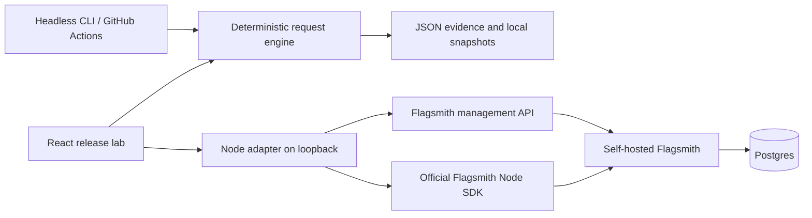

# Architecture

## Engine

Each simulated second emits 120 requests. A fixed linear-congruential random stream supplies exposure, latency jitter, failure draws, and fault jitter. The generator consumes the same number of draws across branches, enabling meaningful guarded-versus-unguarded comparisons. Four cohorts have consistent traits. No timer or precomputed success sequence repairs the application.

The checkout scenario injects a failure at second 10. Candidate requests in Mobile · EU have a 70% fault probability and a latency penalty. Every other cohort retains the baseline path. The exact observed rates come from seeded draws, not fixed metric labels.

A point collects request count, errors, P95 latency, and candidate outcomes. Cohort guardrails inspect a rolling three-second window and require at least 20 requests. A consecutive-breach counter prevents a single noisy second from requesting rollback. Automatic checkout rollback is intentionally specific to the checkout scenario; toggling a checkout flag is not a remedy for a database outage.

## State machine

`ready → running ↔ paused → completed`. A reset creates a fresh state while preserving current flags, selected policy, scenario, and seed. Switching scenarios creates a fresh sandbox with default flags. A remote rollback enters a pending state. Only acknowledgment updates the flag; failure pauses the run and leaves the flag enabled in the local model.

The UI operates at 1×, 2×, or 4× wall-clock speed, but each step always represents exactly one simulated second. Counterfactual comparisons run the same engine synchronously.

## Flagsmith adapter

The SDK uses remote evaluation with caching and SDK analytics disabled. The environment endpoint supplies global flag states; 100 transient identity evaluations supply candidate exposure decisions. Numeric remote config is interpreted as a rollout percentage using a stable application-side bucket. This explicitly distinguishes Switchyard bucketing from Flagsmith's own percentage-split rules.

Writes use the documented management API environment feature-state resource. A write is not declared successful until:

1. The PATCH acknowledges the desired enabled state.
2. A fresh environment SDK evaluation matches it.
3. For checkout rollback, reevaluating the 100 lab identities finds no active checkout candidate, including overrides.

The adapter limits concurrency to eight evaluations, bounds request durations, follows same-origin management pagination only, and allowlists the three lab flag names. Server credentials never appear in client responses. Management mutations require an explicit environment opt-in. Origin and Host checks protect the local adapter from foreign web pages and DNS rebinding. This is a local developer tool: exposing it publicly would additionally require real authentication and authorization.

## Persistence and portability

Browser snapshots keep the complete recorded state in localStorage, capped at eight runs. Storage failures are surfaced. Exported evidence includes the simulation seed, scenario, final flags, thresholds, full event timeline, per-cohort results, and time series. Snapshots preserve results; comparison replay regenerates the default scenario and does not promise to reconstruct arbitrary manual interventions. The CLI emits the same evidence schema.

## Hosting

The deployed preview is a static browser sandbox. It never contains server-side SDK keys. The complete Docker/Node deployment adds the real Flagsmith adapter. The Compose topology follows the official Flagsmith combined-image deployment guide and includes a migration job and task processor.

## Connected verification

The self-hosted stack and connected rehearsal passed in [GitHub Actions run 44396236912](https://github.com/mario-lindev/switchyard/actions/runs/44396236912). The workflow bootstraps an ephemeral real Flagsmith project and environment, evaluates identities, rehearses the checkout failure, mutates the actual feature state, verifies read-back, and uploads `connected-evidence.json`. The regression test suite also covers numeric feature IDs returned by the real management API.
